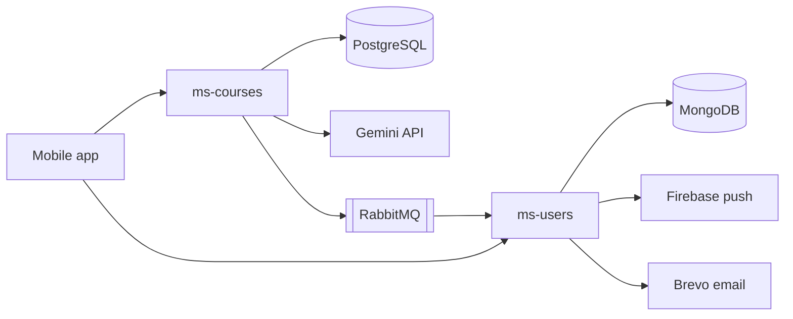

# ClassConnect

Backend for ClassConnect, a mobile app where teachers create courses and exams and students enroll, submit work and get feedback.

We built it as a team project at FIUBA (Universidad de Buenos Aires).

## How it's organized

It has two services, each with its own database:

| Service | Stack | What it handles |
| :--- | :--- | :--- |
| `ms-courses` | Python, FastAPI, SQLAlchemy, PostgreSQL | Courses, modules, enrollments, exams, submissions, feedback and stats |
| `ms-users` | Go, Gin, MongoDB | Users, profiles, roles, and sending notifications |



Both services check the user's Firebase token on each request. When something happens in a course (a new exam, a grade, and so on), `ms-courses` publishes a message to RabbitMQ. `ms-users` picks it up and sends the push notification or email, so neither service has to wait on the other.

Open-ended exam answers are sent to Gemini with a grading prompt. We parse the reply into a score and a comment for the student and save both. The tests mock the model so they don't depend on the API.

Both services send traces to Datadog APM. Each one deploys to Heroku from GitHub Actions, and `ms-courses` also runs Ruff and its tests in Docker Compose before deploying.

## What I worked on

In `ms-courses` I built the Gemini grading, the courses, modules and enrollments endpoints, and the stats endpoints. I also added the Datadog instrumentation, reworked part of the Heroku deploy and wrote part of the tests. I made some changes to `ms-users` as well, but I didn't build that service or the notifications.

## Running it

Each service has its own Docker Compose file.

```bash
cd ms-courses
cp .env.example .env    # fill in the database settings and GEMINI_API_KEY
docker compose up --build
```

```bash
cd ms-users
cp .env.example .env
docker compose --env-file .env up --build
```

To run the tests, use `docker-compose.test.yml` in each folder:

```bash
docker compose -f docker-compose.test.yml up --build --abort-on-container-exit
```
